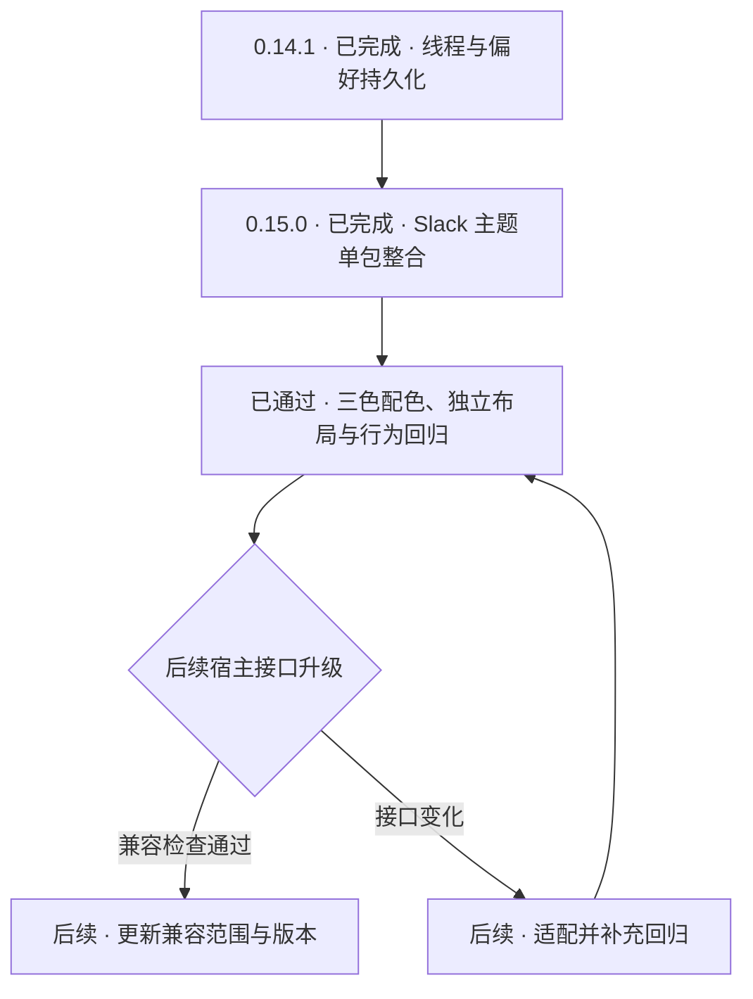

# DeepSeek Harness Threads

DeepSeek Harness（DSH）侧边线程对话插件，提供独立回复面板、Slack 消息布局及原生／Slack／爵士三种界面配色。点击任意一轮回答下的「回复」，即可在右侧栏继续追问。

当前版本：**0.15.0** · 包名：`dsh-threads` · [版本下载](https://github.com/LeoAndJellyfish/DeepSeek-Harness-Threads/releases/tag/v0.15.0) · [问题反馈](https://github.com/LeoAndJellyfish/DeepSeek-Harness-Threads/issues)

## 安装

### Web 版（`dsh web`）

从 GitHub 安装固定版本：

```powershell
dsh plugin --profile web add github:LeoAndJellyfish/DeepSeek-Harness-Threads#v0.15.0
```

安装完成后重启 `dsh web`，刷新浏览器。在一轮已完成的回答下确认「回复」入口，在设置的「线程与外观」页选择消息布局和界面配色。

安装开发分支当前版本：

```powershell
dsh plugin --profile web add github:LeoAndJellyfish/DeepSeek-Harness-Threads
```

### 官方桌面客户端

在 DSH 桌面端会话中发送以下指令，由宿主内置的 `plugin_manager` 安装到当前桌面 profile：

```text
请使用当前桌面端内置的 plugin_manager 安装
github:LeoAndJellyfish/DeepSeek-Harness-Threads#v0.15.0。
先检查当前 profile 和已安装的同名插件，已有安装时核对来源与版本；
通过工具支持的安装或更新操作完成，并报告实际安装版本和重启要求。
```

桌面端使用宿主管理的 `desktop` profile；上述 `--profile web` 命令用于独立 Web 版。安装后按宿主提示重启，随后检查回复入口。

### 离线资源包

下载 Release 中的 `dsh-threads-0.15.0.tgz`，在文件所在目录执行：

```powershell
dsh plugin --profile web add ./dsh-threads-0.15.0.tgz
```

也可下载 ZIP，解压后使用包含 `package.json` 的目录绝对路径：

```powershell
dsh plugin --profile web add "file:D:/Plugins/dsh-threads"
```

Release 附带 `SHA256SUMS`，可通过 `Get-FileHash <文件路径> -Algorithm SHA256` 核对下载文件。

### 更新与卸载

更新时使用原安装来源及目标版本，优先通过宿主插件管理界面的更新入口操作。早期本地开发包名为 `@local/dsh-threads`，迁移到公开包前应通过对应 profile 的插件管理入口移除旧注册，再安装 `dsh-threads`。线程和文字草稿存放于 `$DSH_HOME/dsh-threads/store.json`，迁移前可备份该文件。

Web 版卸载：

```powershell
dsh plugin --profile web remove dsh-threads
```

### 运行条件

运行条件：DSH `>=0.2.2-rc.3 <0.2.3-0`，Node.js 24 及以上。当前验证基线为 DSH `0.2.2-rc.3`。

插件使用 DSH 的会话分叉、右侧栏、聊天节点插槽、Theme 服务和 Markdown 模块。客户端声明为 `web`，由 DSH Web 界面加载；官方桌面端通过内置 Web 界面加载。宿主版本升级可能调整这些接口。

## 功能

- 独立线程面板：会话分叉、归档恢复、工具审批、Markdown 与数学公式。
- 线程导航：回复条数、运行状态、未读提示、最近更新时间。
- 消息输入：文字草稿持久化、粘贴与拖拽图片、线程结论引用。
- 可选 Slack 样式：DeepSeek 账号头像与鲸鱼助手标、日期分隔、悬停操作条、折叠插话，以及 `/goal` 命令输入与结果卡片。
- 三种全局配色：原生、Slack 原版（深蓝侧栏、绿色按钮）、爵士蓝；独立于消息布局，支持浅深色模式。
- Host 持久化：线程索引、文字草稿和界面偏好在重启后保留。

## 外观设置与旧主题迁移

设置 →「线程与外观」提供两个独立选项：

| 设置 | 选择 | 作用 |
| --- | --- | --- |
| Slack 消息布局 | 开启／关闭 | 消息行、日期分隔、悬停操作条；标题栏开关同步此偏好 |
| 界面配色 | 原生／Slack／爵士 | 全局 token 与 Slack 深蓝侧栏；跟随宿主浅深色模式 |

`0.15.0` 已合并原独立 `dsh-slack-theme`。同时安装过两包时，先更新 `dsh-threads`，再从同一 profile 卸载 `dsh-slack-theme`，按宿主提示重启。Web profile 示例：

```powershell
dsh plugin --profile web remove dsh-slack-theme
```

已有 `theme: jazz`、消息布局、线程索引及文字草稿继续保留。需要 Slack 原版配色时，在「界面配色」选择「Slack」。选择「原生」或卸载线程插件时，插件释放主题 token、侧栏样式和观察器。

## 用法

1. 刷新页面（安装/升级后需要一次）。
2. 将鼠标移到任意一条**已完成**回答的底部动作行，点气泡图标「回复」。
3. 右侧栏出现「线程」页签：顶部引用被回复的那条回答，下面是回复流和输入框。
4. 第一次发送时才真正创建线程——它是一条从该轮分叉出来的子会话，继承到该轮为止的上下文。
5. 线程存在后，该轮下方会常驻一行「N 条回复」，点它随时回到线程。

## 它是怎么实现的

| Slack | DSH |
|---|---|
| Channel | 会话（Session） |
| 一条消息 | 一轮对话（用户提问 + 助手回答） |
| Thread | 从该轮 fork 出的子会话（`parentSession` 指向主会话） |
| Thread 面板 | 右侧栏 `thread` 页签 |

- 线程索引（主会话 + 锚点 seq → 子会话）及文字草稿持久化于 Host 侧 `$DSH_HOME/dsh-threads/store.json`，浏览器 `localStorage` 提供运行内兜底。对话内容存在子会话日志中；草稿发送成功后清空。
- 助手回复用宿主自己的 Markdown 渲染器（`@deepseek-ai/dsh-client-ui-primitives` 的 `MarkdownText`，web shell 静态模块表提供），和聊天区同一套：CommonMark、KaTeX 数学公式、代码块高亮/复制、脚注。引用卡片也用同一渲染器。
- 每条发进线程的消息都会带一段 `<dsh-thread>` 前缀，告诉分叉出来的 agent「你在侧边线程里，回复只有线程面板能看到」。面板渲染时会把这段前缀剥掉；如果直接用「打开子会话」进主界面，会看到原始前缀。
- 子会话会以缩进形式出现在左侧栏，标题沿用分叉时的递增标题。
- 线程会话在左侧栏被归档后，面板会禁用输入框、显示「已在左侧栏归档」提示，并给一个「恢复会话」按钮；草稿保留，恢复后可直接继续。
- 线程里的 Agent 请求工具确认时，面板底部直接出现审批卡片（工具名、理由、「允许一次 / 拒绝」），和主界面审批 UI 读的是同一份 `PendingApproval` 状态。
- 对话标题栏的「线程」按钮打开本会话的线程列表（按最近更新排序，点一行跳到对应线程页签）。
- 线程页签标题是动态的：显示被回复回答的前 18 个字，同时开几条时能分清。
- 线程页签使用持久资源地址保存锚点，重启后恢复；旧版缺少导航参数的页签显示线程列表，选择后可继续。
- 线程面板的「带回主对话」把线程最后一条回答以引用块写进主对话输入框（不直接发送，你自己决定发不发、改不改）。
- 线程输入框支持粘贴/拖拽图片，按宿主默认限制：最多 20 张、单张 20 MB；超过 2048px 长边或 4 MP 的图会先在浏览器里缩放（WebP，透明底转白）再发送。
- 线程子会话继承父会话的 Agent 预设。新版宿主在分叉时继承；旧版宿主遗漏时，插件补写 `agent-preset/selected`，已有相同预设时跳过。
- 左侧栏里属于线程的子会话行前会显示线程小图标，和普通分支会话区分开。
- 对话标题栏的 Slack 开关（胶囊 + 滑动方块，`role="switch"`）切换消息行样式：Slack 模式下 `user`、`assistant-step`、`steering` 换成头像 + 作者 + 时间的 Slack 行，其余节点仍由宿主渲染；随时可切回原生。
- Slack 行悬停出现整行高亮和浮动操作条（复制、回复进线程、从这个回答分支）。
- Slack 模式下按天插入日期分隔（「今天」「昨天」或「10 月 8 日 星期四」，跨年带年份）；首条消息也显示。
- 用户消息恢复文件卡片（名称/类型/大小）、引用摘要（`referenceLabels`）与技能名（`skillNames`）。
- 中途插入的消息（`steering`）渲染成单行「插话」折叠行，点击展开，不再撑成一条完整消息。
- 线程卡片显示运行中圆点（脉冲）、未读圆点，并在线程完成时刷新条数与最后回复时间。
- 线程输入框可勾选「在主会话展示线程结果」，默认关闭。发送仅触发线程 Agent；主会话在原回答下展示该次请求的状态与结果卡片。流式更新、完成及重试沿用同一卡片。
- 结果卡片提供线程入口，记录保存在 Host 线程索引中。卡片供用户查看；主 Agent 接收结论时，使用「带回主对话」写入草稿，编辑后明确发送。
- 线程面板头部显示最后回复时间与参与者头像，失败时提供「重试」。重试保留失败消息的文字、图片和请求 ID。
- 图片点击打开灯箱（点背景或 Esc 关闭）；正文链接、引用块、代码块使用爵士配色。
- 工具与过程行保留宿主富卡片，只通过 `data-chat-flow-kind` 把外壳缩进对齐到 Slack 正文（Slack 模式下生效）。

## 已知边界

- 线程继承锚点之前的完整上下文，每次回复的输入 token 会变大（前缀缓存可抵消一部分）。
- 「带回主对话」只写草稿，不会自动发送；主对话输入框原有的文字会被保留并接在后面。
- 面板只渲染用户/助手文本（助手部分走完整 Markdown），工具调用折叠成一行，不渲染完整工具卡与轨迹。
- 审批卡片只支持宿主的临时决定（允许一次 / 拒绝）；持久权限策略仍由宿主侧处理。
- 图片只支持图片类型、只存在内存里（切换/重载后需重新粘贴；文字草稿仍然持久化），不支持文件上传。
- 线程列表和索引、草稿、皮肤偏好统一存在 Host 侧 `$DSH_HOME/dsh-threads/store.json`（经 `/dsh-threads/store` 读写，和页面同一套来源/身份校验），端口变化和重启都不丢；`localStorage` 只是同一次运行内的兜底。
- 皮肤偏好与线程索引一起持久化在 Host store；目前替换了 `user` / `assistant-step` / `steering` 三类节点，工具卡、过程行仍由宿主渲染；被替换的行暂未提供宿主原有的编辑/重发交互（复制、回复、分支已补）。
- 有插话的轮次过程组会被宿主强制展开（`hasInterleavedInput`），无法从节点渲染器改变；要改需接管 `conversation.chat.flow`，暂缓。
- 深色模式的对比度只做了静态检查的一部分：亮色下 `#14ADFF` 对白底仅 2.48，已改用深一档的 `--sk-azure-ink` 承担文字；深色块的 token 解析仍未验证。
- Markdown 渲染器来自宿主的静态模块表（`dsh.client.external` 声明）；宿主大版本改名时这里需要跟着改，缺省会退化为纯文本。

## 文件

- `client.js` — 全部客户端逻辑：线程索引、回复入口、右侧面板、Slack 皮肤。
- `index.js` — Host 半边：`/dsh-threads/store` 持久化路由 + 线程子会话的 Agent 预设继承。
- `cordis.patch.yml` — 安装入口。

## 开发与验证

```powershell
npm run check
npm test
npm pack --dry-run
```

92 项行为回归覆盖并发保存、键级合并、异步草稿恢复、保存失败重试、发送失败及图片重试、主会话被动结果卡片、回复统计、未读状态、Slack 内容展示，以及配色切换、旧偏好恢复和主题资源清理。测试使用临时目录及内存宿主，不读取现有 DSH 会话或存储文件。

客户端通过 `/dsh-threads/store` 的 PATCH 接口提交发生变化的线程、草稿及外观偏好；Host 在写入队列内完成合并。保存失败时，面板显示提示并保留本地变更，最多自动重试三次，也可点击「重试保存」。旧版 PUT / POST 完整快照接口继续保留。Host 与客户端应同时更新。

## 路线图



本轮交付为 Slack 原版色板、三种配色选择及统一生命周期管理；运行条件记录于 `package.json`。发行前执行语法检查、全部行为回归及打包校验，GitHub Actions 同步验证 Windows / Linux。每次发行提供 TGZ、离线 ZIP 和 `SHA256SUMS`。
